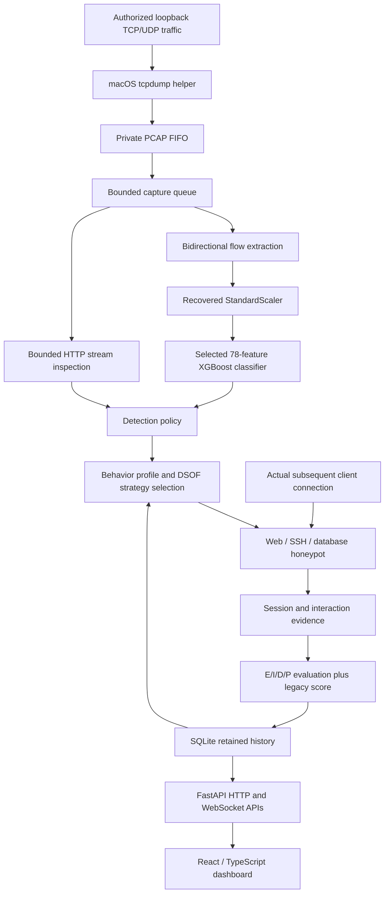

# Implemented architecture

The normal user runs `python -m dsof run`. Only the separate tcpdump process
needs administrator privileges. `dsof.pcap_pipe.PipeCollector` validates the
PCAP header/record lengths and decodes complete packets through Scapy before
using the existing bounded collector queue. Loopback endpoint scope and
configured control/honeypot-port exclusions are applied in the collector.
Malformed input or a failed consumer stops capture truthfully. Writer loss
moves capture to waiting state. No synthetic packets are used in production.

`dsof.runtime.Runtime` owns SQLite, the control token and engine lifecycle.
`dsof.api.create_app` starts and closes that runtime through FastAPI lifespan.
FastAPI serves the compiled frontend, JSON APIs, operator cookie login and
one-second authoritative WebSocket snapshots. `dsof.app` remains a legacy
Flask compatibility implementation exercised by the pre-existing tests; it
is not the normal server entry point.

`dsof.engine.Engine` loads the selected model and scaler once, extracts flow features,
keeps HTTP rules separate from ML predictions, profiles recent completed
flows, runs the optimizer and requests an idempotent verified listener.
Sessions are linked using a test UUID or a recent matching source/deployment.
Only actually received interactions produce DSI evidence.

`dsof.ssh_service` implements real SSH transport with Paramiko. The virtual
shell never delegates to subprocesses, real files or network clients.
Forwarding/SFTP are not enabled. Host keys are stored privately beside the
local database. HTTP and database emulators are also bounded and execute no
submitted content. These are local low-interaction services, not virtual
machines or a production containment boundary.

Diversion telemetry covers configured protected ports on selected capture
interfaces during an observed honeypot session. The result is an explicit
connection-share proxy. Missing coverage or known processing loss produces
unknown D and unknown total EIDP DSI. Kernel capture loss remains unknown.

On shutdown the collector, flow worker, listener sockets and database are
closed. Startup recovers interrupted session/listener records without
inventing engagement during downtime. A process lock prevents duplicate
normal server instances. Restart the external capture helper after a backend
restart.
